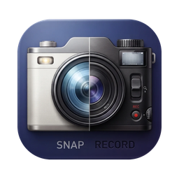

<p align="center">
  
</p>

<h1 align="center">Snap</h1>

A simple, intuitive screenshot and screen recorder for macOS and Windows, built with Electron.

I wanted an app of my own that makes taking a screenshot or a quick video while using my machine simple and fast, without extra steps or clutter.

Press a shortcut, drag over any part of the screen, then either annotate and save a screenshot or record that area as video.

## Features

- **Area capture:** press the shortcut, drag to select a region of the screen.
- **Screenshot mode:** annotate the capture with pen, highlighter, line, arrow, rectangle, ellipse, text, and a pixelate tool for hiding sensitive info. Pick any color from a palette (or type a hex value) and choose a size (S/M/L/XL) for line width and text. Resize the selection with its handles, then undo, copy to the clipboard, or save as PNG/JPG.
- **Full screen:** one click captures the whole display.
- **Tooltips:** hover any button to see what it does.
- **Video mode:** record the selected area with a 5-second countdown (configurable). Toggle system sound and microphone before you start. A small stop bar with a timer appears outside the recording.
- **Mode bar:** switch between Screenshot and Video at the top of the capture screen. Snap remembers your last choice.
- **Settings:** change the shortcut, default save folder, ask-where-to-save or auto-save, screenshot format, countdown length, and default audio toggles.
- **Tray app:** runs in the menu bar / system tray. Also reachable from the Dock icon menu and `Cmd/Ctrl+,`.

## Usage

| Action | How |
| --- | --- |
| Start a capture | `Cmd/Ctrl+Shift+S` (changeable), tray icon, or Dock icon |
| Cancel | `Esc` |
| Copy screenshot | `Cmd/Ctrl+C` or the Copy button |
| Save screenshot | `Cmd/Ctrl+S` or the Save button |
| Undo last drawing | `Cmd/Ctrl+Z` |
| Stop a recording | Stop button, the capture shortcut, or a click on the Dock icon |
| Open settings | ⚙️ in the capture screen, tray menu, Dock menu, or `Cmd/Ctrl+,` |

Videos are saved as `.mp4` when supported, otherwise `.webm`. Settings are stored in `settings.json` in the app's user data folder.

## Run from source

Requires Node.js.

```bash
npm install
npm start
```

## Build the macOS installer

```bash
CSC_IDENTITY_AUTO_DISCOVERY=false npm run dist
```

The DMG is written to `dist/`. The build is unsigned and targets the architecture of the machine that builds it. A Windows installer can be built with `npm run dist -- --win`, ideally on a Windows machine.

## macOS permissions

- **Screen Recording:** required. Enable Snap in System Settings > Privacy & Security > Screen Recording, then quit and reopen Snap.
- **Microphone:** requested the first time you record with the microphone on.

Because the app is unsigned, macOS ties the permission to each specific build. After installing a new build you may need to grant it again. On first open, right-click the app and choose Open, or run `xattr -cr /Applications/Snap.app`.

## Status

Early release (v0.1.0). It works as a personal tool but is not production grade: the build is unsigned and not notarized, there is no auto-update, and there are no automated tests. Use at your own risk.

## Known limitations

- System sound capture uses Electron's loopback audio and should work on macOS 13 or later and on Windows. It has not been tested on every setup.
- Video records one rectangular area of a single display, with no on-screen outline while recording.
- No blur tool, upload or share links, or auto-update.
- Only tested on macOS (Apple Silicon), and not every flow was exercised. Windows and Intel Macs are untested.
- Not code-signed or notarized, so macOS and Windows SmartScreen will warn on first launch.

## Project layout

| File | Purpose |
| --- | --- |
| `main.js` | App lifecycle, tray, shortcut, capture, saving, settings storage |
| `preload.js` | Bridge between the windows and the main process |
| `overlay.html` | Area selection, annotation tools, mode bar |
| `recorder.html` | Hidden window that records and crops the video |
| `control.html` | Recording timer and stop bar |
| `countdown.html` | Countdown before recording |
| `settings.html` | Settings window |
| `home.html` | Small launcher window |

## Contributing

Issues and pull requests are welcome, especially Windows testing, signing/notarization setup, and automated tests.

## License

[MIT](LICENSE) © 2026 Daniel Shalom
