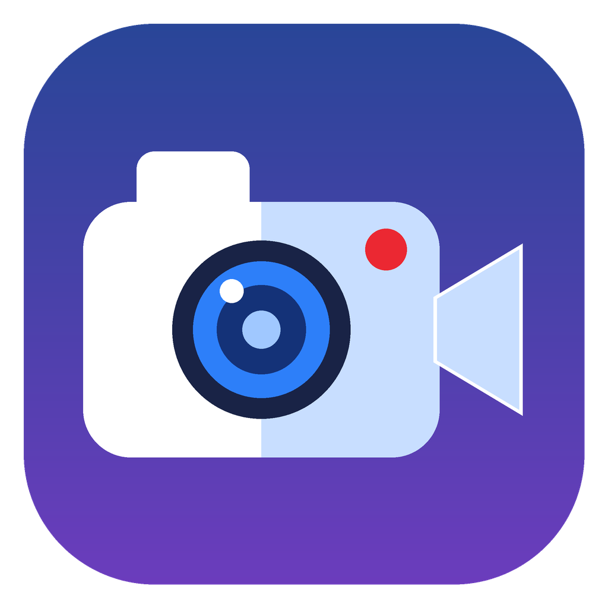

<p align="center">
  
</p>

<h1 align="center">Snap</h1>

A simple, intuitive screenshot and screen recorder for macOS and Windows, built with Electron.

I wanted an app of my own that makes taking a screenshot or a quick video while using my machine simple and fast, without extra steps or clutter.

Press a shortcut, drag over any part of the screen, then either annotate and save a screenshot or record that area as video.

## Features

- **Area capture:** press the shortcut, drag to select a region of the screen.
- **Screenshot mode:** annotate the capture with pen, highlighter, line, arrow, rectangle, ellipse, text, and a pixelate tool for hiding sensitive info. Pick any color from a palette (or type a hex value) and choose a size (S/M/L/XL) for line width and text. Resize the selection with its handles, then undo, copy to the clipboard, or save as PNG/JPG.
- **Full screen:** one click captures the whole display.
- **Tooltips:** hover any button to see what it does.
- **Video mode:** record the selected area with a 5-second countdown (configurable). Toggle system sound and microphone before you start. A small stop bar with a timer appears outside the recording.
- **Two shortcuts:** one for screenshots and one for video, so you go straight to selecting an area. The tray icon and Snap window show a Screenshot / Video switch instead.
- **Settings:** change the shortcut, default save folder, ask-where-to-save or auto-save, screenshot format, countdown length, and default audio toggles.
- **Tray app:** runs in the menu bar / system tray. Also reachable from the Dock icon menu and `Cmd/Ctrl+,`.

## Usage

| Action | How |
| --- | --- |
| Take a screenshot | `Cmd/Ctrl+Shift+S` (changeable in Settings) |
| Record a video | `Cmd/Ctrl+Shift+R` (changeable in Settings) |
| Capture with a mode switch | tray icon or the Snap window |
| Cancel | `Esc` |
| Copy screenshot | `Cmd/Ctrl+C` or the Copy button |
| Save screenshot | `Cmd/Ctrl+S` or the Save button |
| Undo last drawing | `Cmd/Ctrl+Z` |
| Stop a recording | Stop button, either shortcut, or a click on the Dock icon |
| Open settings | ⚙️ in the capture screen, tray menu, Dock menu, or `Cmd/Ctrl+,` |

Videos are saved as `.mp4` when supported, otherwise `.webm`. Settings are stored in `settings.json` in the app's user data folder.

## Install

There is no published download yet, so you build the installer once from source. You need [Node.js](https://nodejs.org) and [Git](https://git-scm.com).

### macOS

1. Get the code and build the installer:
   ```bash
   git clone https://github.com/ponya5/snap.git
   cd snap
   npm install
   CSC_IDENTITY_AUTO_DISCOVERY=false npm run dist
   ```
2. Open `dist/Snap-0.1.0-arm64.dmg` and drag **Snap** into **Applications**. Then eject the Snap disk in Finder.
3. Open Snap from Applications. If macOS says it can't verify the app, right-click Snap, choose **Open**, then **Open** again. Or run `xattr -cr /Applications/Snap.app`.
4. Press `Cmd+Shift+S` to take a screenshot or `Cmd+Shift+R` to record a video. When macOS asks, allow Snap under **System Settings > Privacy & Security > Screen Recording**, then quit and reopen Snap.

The DMG matches the architecture of the Mac that built it (Apple Silicon or Intel).

### Windows

1. On a Windows PC, get the code and build the installer:
   ```powershell
   git clone https://github.com/ponya5/snap.git
   cd snap
   npm install
   npm run dist -- --win
   ```
2. Run the installer in `dist/` (`Snap Setup 0.1.0.exe`) and follow the steps.
3. If Windows SmartScreen warns about an unknown publisher, click **More info > Run anyway**. The installer is unsigned.
4. Press `Ctrl+Shift+S` for a screenshot or `Ctrl+Shift+R` to record a video. Snap runs in the system tray (the `^` area next to the clock).

To try Snap without installing, run `npm install` and `npm start` instead.

## Run from source

Requires Node.js.

```bash
npm install
npm start
```

## Build the macOS installer

```bash
CSC_IDENTITY_AUTO_DISCOVERY=false npm run dist
```

The DMG is written to `dist/`. The build is unsigned and targets the architecture of the machine that builds it. A Windows installer can be built with `npm run dist -- --win`, ideally on a Windows machine.

## macOS permissions

- **Screen Recording:** required. Enable Snap in System Settings > Privacy & Security > Screen Recording, then quit and reopen Snap.
- **Microphone:** requested the first time you record with the microphone on.

Because the app is unsigned, macOS ties the permission to each specific build. After installing a new build you may need to grant it again. On first open, right-click the app and choose Open, or run `xattr -cr /Applications/Snap.app`.

## Status

Early release (v0.1.0). It works as a personal tool but is not production grade: the build is unsigned and not notarized and there is no auto-update. Use at your own risk.

## Known limitations

- System sound capture uses Electron's loopback audio and needs macOS 13 or later (or Windows).
- Video records one rectangular area of a single display, with no on-screen outline while recording.
- No blur tool, upload or share links, or auto-update.
- Not code-signed or notarized, so macOS and Windows SmartScreen will warn on first launch.

## Project layout

| File | Purpose |
| --- | --- |
| `main.js` | App lifecycle, tray, shortcut, capture, saving, settings storage |
| `preload.js` | Bridge between the windows and the main process |
| `overlay.html` | Area selection, annotation tools, mode bar |
| `recorder.html` | Hidden window that records and crops the video |
| `control.html` | Recording timer and stop bar |
| `countdown.html` | Countdown before recording |
| `settings.html` | Settings window |
| `home.html` | Small launcher window |

## Contributing

Issues and pull requests are welcome, especially signing/notarization setup and Windows support.

## License

[MIT](LICENSE) © 2026 Daniel Shalom
